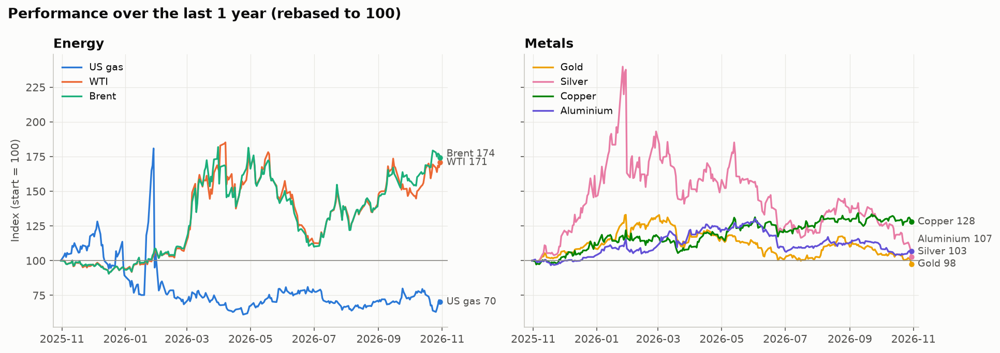

# Commodity Screener: which commodity CFDs suit a retail trader?

**Question:** of seven liquid commodities (US natural gas, WTI, Brent, gold, silver, copper, aluminium), which are worth trading as leveraged CFDs, and what does free data say about each one's risk, trend, seasonality and data quality?

**Short answer (data to 30 Oct 2026):**
- **Copper scores best overall.** Its 1-in-100 day costs about half the margin at 10:1, its drivers are macro and well reported, and it diversifies against energy. The catch: COMEX and the LME split by up to ~30% during the 2025 US tariff episode.
- **Gold and Brent come next.** Gold has the cleanest data and smallest weekend gaps, but its 20:1 leverage cap makes a bad day hurt as much as oil at 10:1. WTI and Brent correlate at 0.94, so trade one, not both.
- **US gas is the worst CFD despite being the most interesting market.** Its 1-in-100 day exceeds the whole margin at 10:1, about one day in four moves enough to trigger a margin close-out, and roll jumps make up about a third of its 2026 volatility.
- **For every commodity, the leverage at which a 1-in-100 day costs 10% of the account is 0.7–2.8x**, far below the 10:1 or 20:1 the broker allows.
- **Seasonality is mostly noise:** 10 "significant" months out of 84 tests, where about 4 are expected by chance.



## Notebooks

| # | Notebook | What it does |
|---|---|---|
| 01 | [Data sources](notebooks/01_data_sources.ipynb) | Loads four free sources through one loader, checks roll jumps, gaps, stale prices, and source agreement. Compares ALI=F and HG=F with LME prices and picks the daily source for each metal. |
| 02 | [Screener](notebooks/02_screener.ipynb) | Volatility, average daily move, 1M/3M/1Y/5Y returns, max drawdown, 50/200-day trend, monthly seasonality, correlation matrix, with charts. |
| 03 | [Scorecard](notebooks/03_scorecard.ipynb) | Translates moves into % of CFD margin at retail leverage, weekend-gap risk, and a pros/cons scorecard with a shortlist. |
| — | [Theses](theses/THESES.md) | Template per commodity: Story, Evidence, Catalysts, Risks, What would prove me wrong. |

## What I learned about the data

- **Continuous futures aren't one contract.** `NG=F` joins front-month contracts end to end, so it jumps on roll days. 93% of NG=F's flagged jumps fall in the second half of the month, when contracts expire.
- **ALI=F is unusable:** 63% of days have zero volume, and the price was flat for about 18 months in 2018–19. LME 3-month aluminium (Westmetall) is used instead.
- **Daily correlation can lie when markets close at different times.** HG=F vs LME copper correlates at 0.56 daily but 0.88 weekly, because the LME official price is set about six hours before COMEX settles.
- **"The oil price" depends on whose oil.** World Bank Brent is *Dated* (physical) Brent, which ran $14–18 above futures in tight months of 2026. A CFD follows the futures.
- **WTI went to −$37.63** in April 2020, so returns are masked wherever the previous price is ≤ 0.

## Project structure

```
Commodity_Screener/
├── commodities/          reusable package imported by every notebook
│   ├── config.py         paths, commodity registry (ticker / page / series id + unit factor per source)
│   ├── sources.py        yfinance, Westmetall, FRED, World Bank fetchers with local cache
│   ├── loader.py         load_price(commodity, source): one interface for every source
│   ├── quality.py        roll-jump, gap, stale-price checks
│   ├── metrics.py        screener, seasonality and CFD-risk maths
│   └── plots.py          charts in one colour-blind-checked palette
├── notebooks/            01-03 now; 04-05 reserved for the gas phases below
├── theses/THESES.md
├── outputs/figures/      PNG charts
├── outputs/tables/       CSV summary tables
└── data/raw, data/processed   git-ignored caches, rebuilt by running notebook 01
```

To add a commodity, add one `Commodity(...)` entry to `config.py`. To switch a commodity's source, change one word in `DAILY_SOURCE`.

## Setup

```bash
pip install -r requirements.txt
cp .env.example .env      # or put the keys in the repo-root .env, which is also found
jupyter lab               # run notebooks 01 → 02 → 03 in order
```

**Free API keys:**
- **FRED:** create an account at <https://fredaccount.stlouisfed.org>, then request a key at <https://fred.stlouisfed.org/docs/api/api_key.html>. Without a key the code falls back to FRED's public CSV download, which works but has no rate-limit guarantees.
- **EIA** (for the gas phase): register at <https://www.eia.gov/opendata/register.php>. The key is emailed to you.

## Data sources and terms

| Source | Used for | Notes |
|---|---|---|
| [yfinance](https://pypi.org/project/yfinance/) | Daily continuous futures | Unofficial Yahoo Finance wrapper. For personal research only. |
| [Westmetall](https://www.westmetall.com/en/markdaten.php) | Daily LME cash / 3-month / stocks, 2008+ | `robots.txt` has no restrictions, but the imprint requires consent to reproduce content, and the prices are LME data. Scraped once per year-page with a 3 s delay and cached locally. **Raw data is git-ignored and not redistributed.** Ask Westmetall before publishing charts of their raw series. |
| [FRED](https://fred.stlouisfed.org) | Monthly IMF prices, 1992+ | No gold or silver series since LBMA data was withdrawn in 2022. |
| [World Bank Pink Sheet](https://www.worldbank.org/en/research/commodity-markets) | Monthly prices, 1960+, incl. EU gas and Japan LNG | The Excel link is found on the page at run time, because it changes with each release. |

## Roadmap

- **04 · US gas deep dive.** Already built as a separate project in [`Energy/US_Gas_Storage`](../Energy/US_Gas_Storage/): EIA weekly storage, report-day reaction using actual change vs the 5-year average as the surprise proxy, weather-based injection forecast, winter outlook. The next step is to link it here and use its storage signal as "Evidence" in the gas thesis.
- **05 · Gas spreads and LNG arbitrage.** Henry Hub vs Europe (TTF) vs Japan LNG. The monthly series are already in the registry (`natgas_eu`, `lng_japan`), and [`Energy/LNG_Netbacks_TTF_HH_JKM.ipynb`](../Energy/LNG_Netbacks_TTF_HH_JKM.ipynb) has the netback logic to build on.
- Retail cost layer: add Trading 212 spreads, overnight funding and roll adjustments per instrument, which free price data can't show.

*Not investment advice. This is a learning project; CFDs are leveraged products and most retail accounts lose money trading them.*
