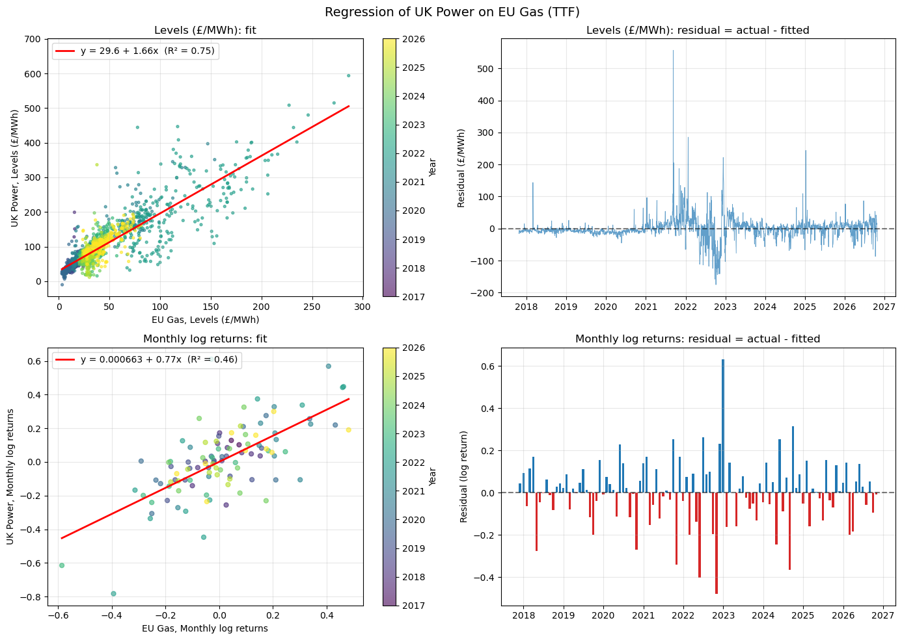
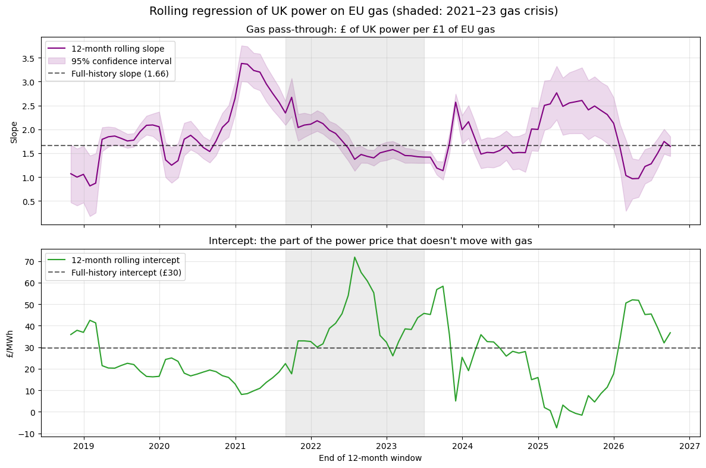
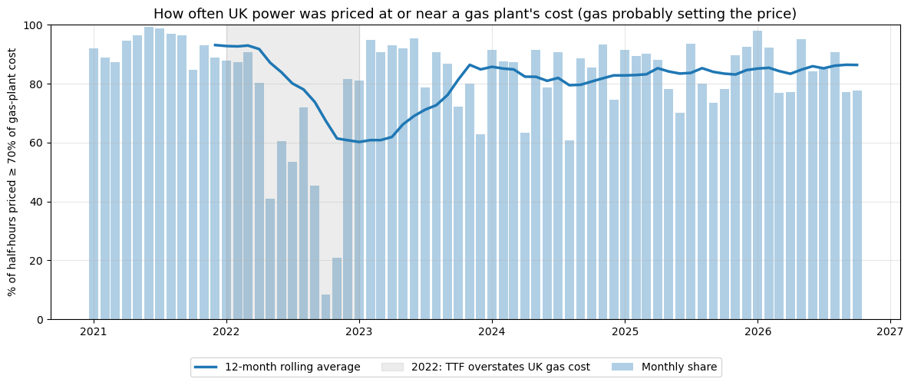
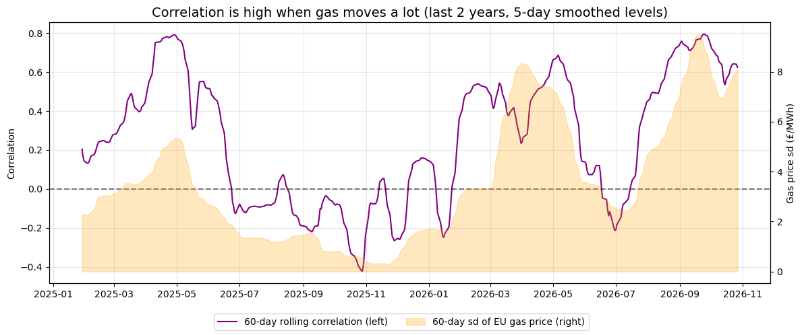
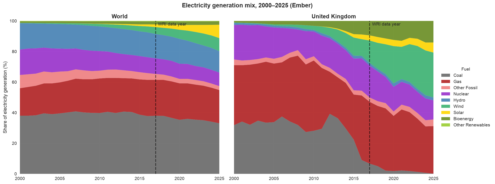
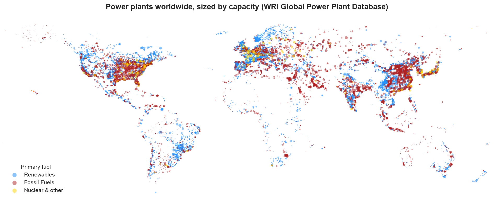
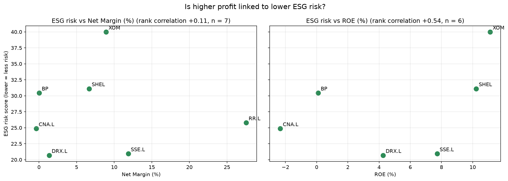

# Energy: UK Power, Gas and the Energy Transition

**Question:** the UK now gets over half its electricity from renewables. Does gas still set the UK power price, and how far has the energy transition actually got, from the world down to individual companies?

**Short answer:**
- **UK power is still priced off gas.** UK power rises by about £1.66/MWh for every £1/MWh rise in European gas, and gas plants set the price in roughly 86% of half-hours in 2026. That share has not fallen as wind and solar have grown.
- **The UK has removed coal, and what's left of fossil power is gas.** Coal fell from 6.7% of UK electricity in 2017 to 0.1% in 2025. Renewables now produce 52%. The remaining 36% fossil share is almost all gas, and gas plants are the flexible ones that fill the gap when wind drops, so they still set the price.
- **The world is moving more slowly.** Wind and solar nearly tripled from 2017 to 2025, but coal still produces a third of global electricity.
- **At company level, ESG risk follows the business, not profit.** The oil majors carry high ESG risk (30–40) and UK power companies medium (21–26), whatever their margins. The company doing the most building, SSE, has *negative* free cash flow because of it.

Data runs to late October 2026. Made by Ittikorn Chanahaworrachai.

---

## 1. UK power is still priced off gas

*Notebook: [UK_Gas_Power_2026](UK_Gas_Power_2026.ipynb)*

I heard that UK power was becoming less dependent on gas as solar and wind grow, so I tested it. The data is half-hourly UK wholesale prices from Elexon (2016–2026) and Dutch TTF gas, the main European gas price, from Yahoo Finance, converted to £/MWh.

### The gas pass-through matches a gas power station's fuel use

**Power ≈ £30 + 1.66 × gas** (£/MWh, R² 0.75). The 1.66 has a physical meaning: a combined-cycle gas plant (CCGT) burns about 1.7 MWh of gas to make 1 MWh of electricity. The £30 is mostly the carbon cost, which doesn't move with gas.

Because of that fixed £30, power always rises by a smaller *percentage* than gas. From August to October 2026, TTF rose about 64% and UK power about 37%. That looks like decoupling, but it isn't: a gas-only model fitted *before* August predicted power would average £139/MWh, and it actually averaged £143/MWh.

### No downward trend in the pass-through

If gas set the price less often, the slope would fall over time. It hasn't: the latest 12 months give **1.64 ± 0.21**, in line with the 2017–2026 average of 1.66. The dip in early 2026 came from a period when gas prices barely moved, so the slope couldn't be measured well. It recovered once the March 2026 gas shock entered the window.

### Gas sets the price in most half-hours, slightly more often than in 2024

For each half-hour, I compared the power price with a gas plant's cost to generate, including carbon. About **86% of half-hours in 2026** were priced at or near gas cost, up from about 83% at the end of 2024. Gas sets the price most in January and February (about 91%).

### Correlation is not the right measure of dependence

The rolling correlation between UK power and gas swings between −0.4 and +0.8. It mostly tracks **how much gas is moving** (r = 0.82 with gas volatility), not how dependent power is on gas. When gas is flat, day-to-day weather noise hides the link.

**What this means for trading:**
- **Hedge ratio:** about 1.6–1.7 MWh of gas per MWh of UK power, the same as the regression slope.
- **Timing:** the gas link is tightest in January and February, so a gas hedge works best in deep winter.
- **Don't trade the percentage gap:** power will always move by a smaller percentage than gas while carbon makes up a fixed part of the price.
- **Watch carbon:** a rise in the UK carbon price lifts power with no change in gas, which can look like decoupling when it isn't.

---

## 2. The energy transition: world and UK

*Notebook: [Energy_transition](Energy_transition.ipynb)*

This project starts from the World Resources Institute's Global Power Plant Database (about 35,000 plants, with output estimated for 2017). It then uses Ember's yearly electricity data to show what has changed up to 2025.

### Coal has gone from UK power; gas is what's left

Share of electricity generation (%), Ember:

| | Fossil | Coal | Gas | Wind + solar | All renewables |
|---|---|---|---|---|---|
| **UK** 2017 → 2025 | 50.0 → 35.6 | 6.7 → 0.1 | 40.4 → 31.1 | 18.1 → 36.0 | 29.2 → 52.0 |
| **World** 2017 → 2025 | 65.3 → 57.4 | 38.0 → 33.1 | 23.5 → 21.7 | 6.2 → 17.3 | 24.5 → 33.8 |
| **China** 2017 → 2025 | 71.0 → 58.4 | 67.1 → 54.6 | 3.1 → 3.0 | 6.4 → 21.8 | 25.2 → 37.0 |
| **USA** 2017 → 2025 | 62.7 → 57.0 | 29.8 → 16.3 | 32.0 → 40.0 | 8.2 → 18.9 | 17.5 → 25.6 |

- **UK:** the last coal plant, Ratcliffe-on-Soar, closed in September 2024. Renewables now produce just over half of UK electricity. Nuclear fell from 20.8% to 12.4% as old reactors retired, so gas is still needed to fill gaps. **This is why section 1 finds gas still setting the price.**
- **World:** wind and solar nearly tripled, but coal is still the largest single source.
- **USA:** coal halved, mostly replaced by gas rather than renewables.

### Where the world's power plants are

The 2017 baseline from the WRI data:
- Renewable plants outnumber fossil plants (25,862 vs 8,660), but fossil plants produced **68% of electricity** and renewables only 20%. Renewable plants are smaller and don't run all the time.
- **Coal alone produced 41%** of the electricity covered by the database.
- **Brazil** stood out, with 83% of its capacity renewable (mostly hydro), against 22% in the USA and 43% in the UK.

---

## 3. Company level: does profit buy sustainability?

*Notebook: [Profit or Planet](Profit%20or%20Planet.ipynb)*

I compared three oil majors with four UK energy companies, using their latest annual reports (FY2025) and Sustainalytics ESG Risk scores. **For ESG risk, lower is better:** below 20 is low risk, 20–30 medium and 30–40 high.

| Company | Business | Net margin | Free cash flow | ESG risk | Share return, 2015–2026 |
|---|---|---|---|---|---|
| ExxonMobil | Oil & gas | 8.9% | $23.6B | 40.0 | 15.5% a year |
| Shell | Oil & gas | 6.7% | $23.9B | 31.1 | 15.3% a year |
| BP | Oil & gas | 0.0% | $11.3B | 30.4 | 13.6% a year |
| Rolls-Royce | Aero engines, small nuclear reactors | 27.5% | $4.7B | 25.8 | 25.2% a year |
| Centrica | Gas supply (British Gas) | −0.4% | $0.2B | 24.9 | 1.4% a year |
| SSE | Wind farms and electricity networks | 11.9% | −$1.4B | 20.9 | 7.8% a year |
| Drax | Biomass power | 1.4% | $0.7B | 20.7 | 15.5% a year |

*Share returns are the average annual return of daily prices from October 2015 to October 2026.*

- **More profit does not mean lower ESG risk.** If anything the link is the other way: the more profitable firms (by return on equity) carry *more* ESG risk. With only seven companies, though, this isn't a real relationship.
- **The business decides the score.** Oil majors score high risk mainly because of environmental exposure; UK power companies score medium.
- **The transition shows up in cash flow.** SSE has a healthy margin and nearly the lowest ESG risk, but negative free cash flow, because it is spending more on grid and wind than its operations bring in.
- **The market hasn't rewarded low ESG risk so far.** The oil majors returned 14–16% a year, against 8% for SSE.

---

## How the three fit together

1. **World:** the transition is under way but slow, and coal still dominates.
2. **UK:** further ahead. Coal is gone and renewables are over half of generation, but **gas is now the swing fuel**, the one that fills the gap whenever wind and solar fall short.
3. **Price:** because gas fills those gaps, it still sets the UK power price in most half-hours. More wind hasn't loosened the link yet.
4. **Companies:** the firms building the transition (SSE) are paying for it in cash flow today, while the oil majors earn the higher returns.

**What would change the picture:** more battery storage and interconnectors taking over the "fill the gap" role from gas. If that happens, the share of half-hours set by gas, and the 1.66 pass-through, should start to fall. Re-running the section 1 tests each winter would show it.

---

## Notebooks

| Notebook | What it does |
|---|---|
| [UK_Gas_Power_2026](UK_Gas_Power_2026.ipynb) | UK half-hourly power vs TTF gas: correlation, regression, out-of-sample residual, rolling slope, share of half-hours set by gas |
| [Energy_transition](Energy_transition.ipynb) | WRI power plant database (2017 baseline) and Ember generation mix (2000–2025) for the world, UK and major countries |
| [Profit or Planet](Profit%20or%20Planet.ipynb) | Share returns, financial ratios and ESG risk for 7 oil and UK energy companies |
| [UK merit order model](UK%20merit%20order%20model/) | Simple merit order stack: how generators' running costs set the market clearing price |
| [LNG_Netbacks_TTF_HH_JKM](LNG_Netbacks_TTF_HH_JKM.ipynb) | US LNG export margins to Europe and Asia; Henry Hub, TTF and JKM spreads |
| [Brent_Crude](Brent_Crude.ipynb) | Brent log returns and volatility |
| [US_Gas_Storage](US_Gas_Storage/) | Does the weekly EIA storage report move Henry Hub prices? (has its own README) |

Charts are in [figures/](figures/), one folder per project.

## Data sources

| Data | Source | Notes |
|---|---|---|
| UK wholesale power, half-hourly | [Elexon BMRS](https://data.elexon.co.uk/) Market Index Data | Cached in `uk_power_mid.csv` |
| TTF gas, Henry Hub, Brent, FX | Yahoo Finance | Cached to CSV on first run |
| Power plants (2017) | [WRI Global Power Plant Database v1.3](https://datasets.wri.org/dataset/globalpowerplantdatabase) | Cached in `data/` |
| Generation mix (2000–2025) | [Ember yearly electricity data](https://ember-energy.org/data/yearly-electricity-data/) | Generation shares cached in `data/` |
| Company financials | Yahoo Finance (FY2025 annual reports) | Cached in `data/` |
| ESG Risk scores | Sustainalytics via Yahoo Finance | Yahoo stopped serving these in 2026; the last retrieved scores are kept in `data/` |

**Reproducibility:** every notebook saves its downloads to CSV on the first run, so later runs give the same numbers without the internet. As of 1 November 2026, Yahoo returns no history for TTF (`TTF=F`), so the UK Gas Power and LNG notebooks can't be re-run from scratch until it comes back. The UK Gas Power charts here are from the 28 October 2026 run.

## Limitations

- **TTF stands in for the UK gas price.** The UK's own price (NBP) isn't freely available. The two usually trade close together, but not in 2022.
- **Carbon prices are annual averages,** and wind output and demand are not modelled directly.
- **The WRI generation figures are estimates** for the plants in its database. For 2017 it gives 19.6% renewables against Ember's 24.5%, so the WRI shares are a rough picture.
- **The company comparison uses one year of financials, one ESG snapshot and seven companies.** It describes these firms, not the sector.
