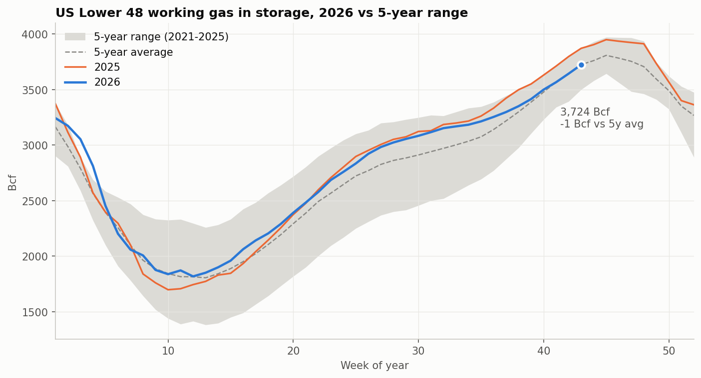
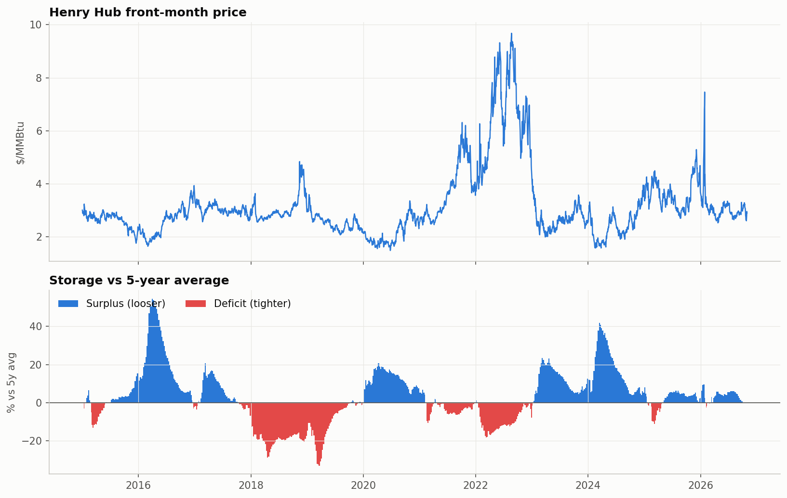
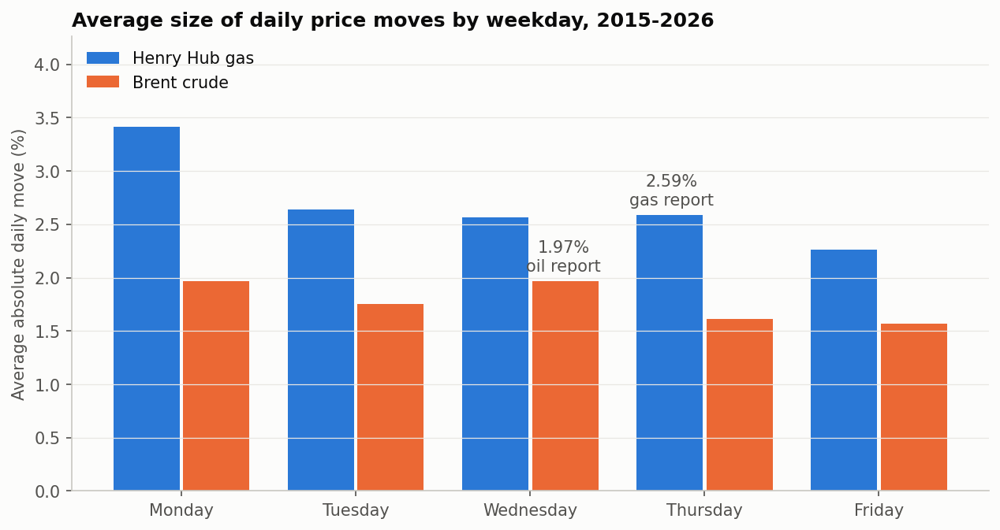
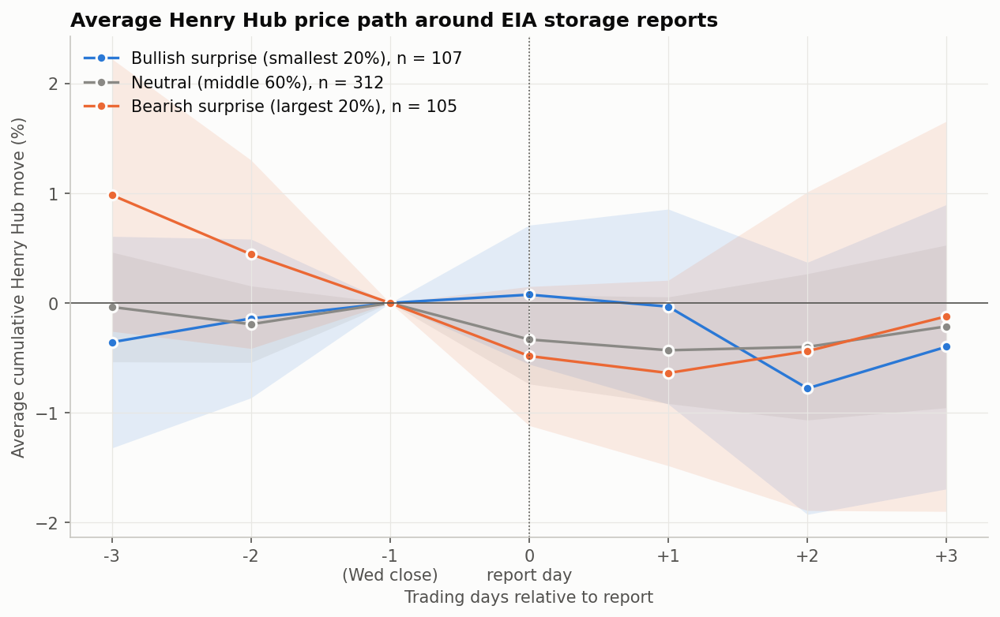
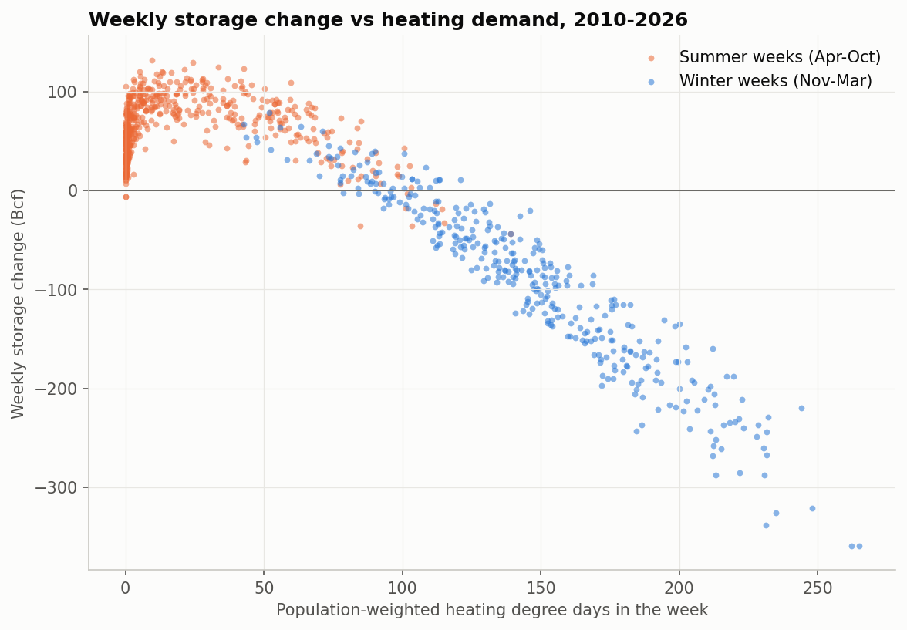
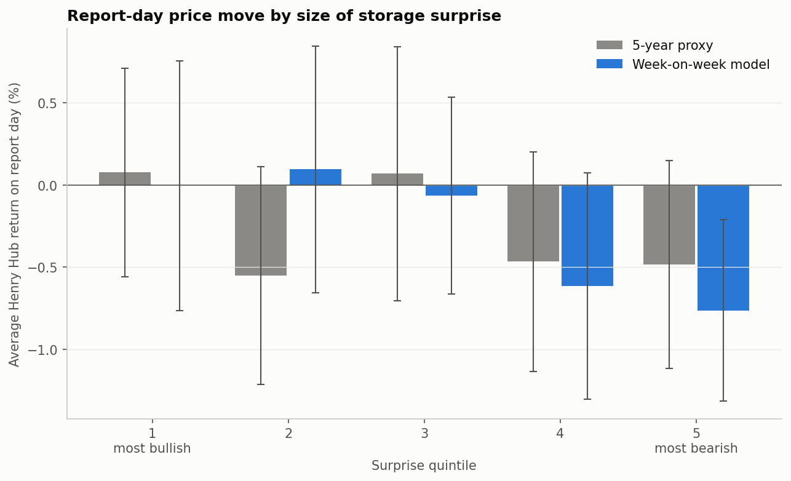
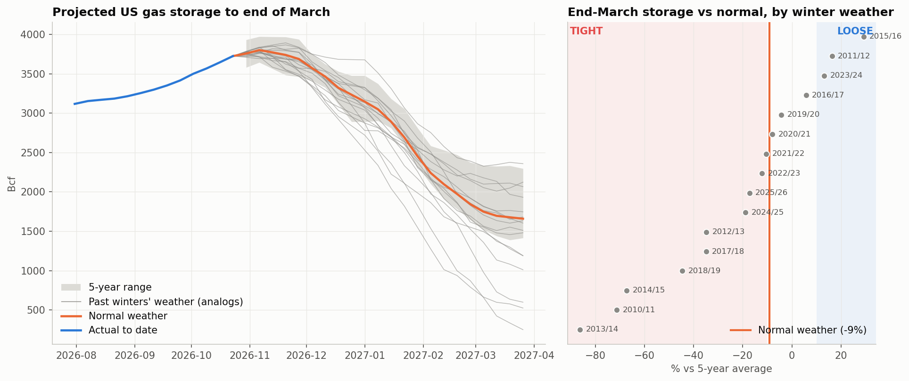
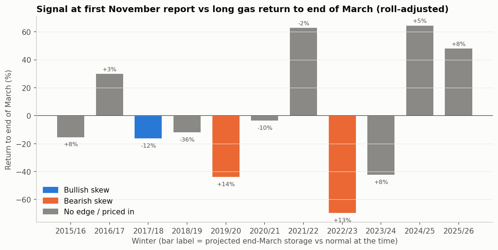

# US Natural Gas: Storage and the Weekly EIA Report

**Question:** do Henry Hub gas prices react to the EIA's weekly storage report, and could a retail trader use storage data to decide whether to invest?

**Short answer:**
- **The weekly report is not a retail edge.** The market reacts to the gap between the reported number and what it expected, not the gap from normal. My weather-based surprise does move report-day prices (p ≈ 0.02), but the effect is small (R² ≈ 1%).
- **Over a whole winter, storage is more useful, but only on one side.** A "loose storage" signal preceded falling prices in 7 of 11 past winters. A "tight storage" signal did not reliably precede rising prices.
- **Winter 2026/27: no edge, leaning tight.** Details are in the [verdict](#so-can-you-trade-it) below.

---

## Background

Every Thursday at 10:30 New York time, the US Energy Information Administration (EIA) publishes how much natural gas went into or out of underground storage the previous week. Storage works as the market's balance sheet. It fills from April to October and empties over winter. When storage is below normal for the time of year, the market is tight and prices tend to rise.

Traders don't react to the raw number; they react to the **surprise**. Professional consensus forecasts aren't freely available, so I tested two proxies:
1. **Actual change minus the 5-year average change** for the same week (the simple proxy)
2. **Actual change minus my own forecast** built from weather data (notebook 04)

## Notebooks

| Notebook | What it does |
|---|---|
| [01_data](01_data.ipynb) | Pulls weekly Lower 48 storage from the EIA API and daily Henry Hub (`NG=F`) and Brent (`BZ=F`) prices; builds the 5-year average surprise |
| [02_storage_vs_price](02_storage_vs_price.ipynb) | Storage against its 5-year range; price against the storage surplus/deficit; oil against gas in the same energy units |
| [03_report_reaction](03_report_reaction.ipynb) | Are report days more volatile? Does the surprise predict direction? Event study around each release |
| [04_injection_forecast](04_injection_forecast.ipynb) | Weather-driven storage forecast from heating and cooling degree days; re-tests the price reaction with the better surprise |
| [05_winter_outlook](05_winter_outlook.ipynb) | Projects end-of-winter storage under 16 past winters' weather, applies threshold rules (Tight / Normal / Loose and cheap / fair / expensive), and backtests the rules on 11 winters |

Shared code is in [gasdata.py](gasdata.py) (data fetching, contract roll handling, regression test) and [style.py](style.py) (chart style).

---

## Key findings

### 1. Storage was back to normal heading into winter 2026

On 23 Oct 2026, storage was 3,724 Bcf, just 1 Bcf below the 5-year average. A surplus that built up earlier in the year disappeared in September, when weekly injections came in 24–34 Bcf below normal. With storage at normal levels, **weather becomes the main driver of winter prices**.

### 2. Storage explains price, but the effect is lopsided

| Storage vs 5-year average | Median price | 90th-percentile price |
|---|---|---|
| Deficit (more than 10% below) | $2.95 | **$8.03** |
| Normal (within ±10%) | $2.96 | $4.37 |
| Surplus (more than 10% above) | $2.18 | $2.99 |

- **Surpluses push price towards a floor** of about $2.
- **Deficits don't raise the typical price,** but they make spikes possible: the 90th percentile nearly doubles. A deficit only turns into a spike when something else goes wrong, such as a cold winter in 2022.
- **The correlation is -0.43 on price levels and -0.28 on 4-week changes.** Changes give the more honest figure, because price levels trend.

**Gas and oil are separate markets.** The correlation of weekly returns is +0.09, and Brent costs about 6.7 times as much as Henry Hub per unit of energy (the average since 2015 is about 4 times).

### 3. On daily data, Thursdays are not more volatile

Report days average 2.59% absolute moves, against 2.71% on other days (p ≈ 0.74).

- **Monday is the most volatile day.** Weather forecasts change over the weekend while the market is closed.
- **The report's price spike fades within the hour.** Studies using minute-by-minute data find a sharp move in the minutes after 10:30. Over a full day, changes in weather forecasts swamp it.
- **The oil control group behaves as expected:** Brent's biggest moves are on Wednesdays (when EIA publishes oil inventories, level with Monday), not on gas-report Thursdays.

### 4. The 5-year "surprise" is mostly not a surprise

The 5-year proxy has no predictive power for direction: the slope is about 0 and the hit rate is 52.5%. The event study shows why. Before bearish reports, prices were **already falling by about 1% over the three days before the release**. Traders forecast each week's number from the weather, so by Thursday most of the gap from normal is already priced in.

### 5. A weather-based forecast is far better, and its surprise does move price

Weekly storage change and heating degree days have a correlation of **-0.91**. Heating demand dominates the US winter gas balance. I built a "week-on-week" model: last week's actual change, adjusted for how much colder or warmer this week is. It is refitted every week on the previous 3 years only, so there is no look-ahead.

| | 5-year average | Weather model |
|---|---|---|
| Average forecast miss (out of sample, 2015–2026) | 31 Bcf | **17 Bcf** |
| Surprise vs report-day return: slope | ≈ 0 (p ≈ 0.95) | **-0.15% per 10 Bcf (p ≈ 0.02)** |
| Hit rate | 52.5% | 54% |

**77% of the variation in the 5-year "surprise" could be predicted from weather before the report was released.**

With the weather-model surprise, report-day returns step down as expected. The two most bearish quintiles average **-0.6% to -0.8%**, while bullish surprises barely move the price. The effect shows up mainly in **summer** (p ≈ 0.008). In winter, forecasts of the coming week's weather matter more than the storage figure for the week just gone.

### 6. Winter outlook: thresholds, verdict and backtest

The weekly model projects storage to the end of March, starting from the 5-year average path and adjusting for how much colder or warmer each week is than normal. The rules are:

| Projected end-March storage | Price cheap (< 25th pct) | Price fair | Price expensive (> 75th pct) |
|---|---|---|---|
| **Tight** (> 10% below normal) | Bullish skew | Bullish skew | Priced in |
| **Normal** (±10%) | No edge | No edge | No edge |
| **Loose** (> 10% above normal) | Priced in | Bearish skew | Bearish skew |

"Cheap" and "expensive" compare today's price with past prices in the same storage state.

**Backtest results, using only information available at the time** (roll-adjusted return of a long position held to end-March):
- **Bearish skew** (7 winters): average **-17.7%**, and prices fell after 80% of the weekly signals. **This signal worked.**
- **Bullish skew** (6 winters): average -5.5%, and prices rose after only 30% of signals. **This signal didn't work.** Tight storage only leads to a spike if the winter is actually cold.
- **No edge:** returns ranged from -42% to +64%, which is pure weather risk.

**How accurate is the projection?** Its average miss is 221 Bcf under normal weather (175 Bcf even with the weather that actually happened), about the same size as the ±10% threshold. Calls near a threshold are therefore uncertain.

---

## So, can you trade it?

**Verdict, 1 Nov 2026: no trade. There's no edge this winter, and the risk leans to the upside.**

- **This winter's position:**
  - **Storage:** under normal weather it ends March at -9.1% vs normal, 1 point from the Tight threshold. 62% of past winters' weather (and 4 of the last 5) would leave it Tight.
  - **Price:** $2.90 is fair for that storage state.
- **No long:** the backtest shows tight storage alone hasn't paid. A long position would be a bet on a cold winter.
- **No short:** the one signal with a good record (bearish skew) is absent, so shorting gas into this winter goes against the fundamentals.
- **What would change the view:** mild weather forecasts pushing the projection towards +10% while the price is not cheap. That would be the historically reliable bearish setup.

**Why the weekly report itself isn't tradeable:**
- **The effect is too small to beat costs.** The surprise explains about 1% of report-day moves. The average gap between the most bearish quintile and the rest is under 1%, while a gas CFD's spread widens around 10:30, and overnight funding and contract roll costs add up.
- **My forecast is worse than the market's.** My model misses by about 17 Bcf on average. Professional consensus forecasts typically miss by single digits, because they use gas-weighted weather, daily pipeline flow data, LNG export flows and holiday adjustments. The market trades against *their* number, so my "surprise" is only a noisy version of the real one.
- **Daily closing prices can't measure the reaction properly.** The real move happens within minutes of 10:30, and a daily return mixes it with everything else that happened that day.

**What the analysis does support:**
- **Treat 10:30 New York time on Thursdays (15:30 UK) as a risk event.** Spreads widen and prices can jump, so a stop-loss may fill far from where it was set. Trade smaller, or stay out, over the release.
- **Gas is about weather.** Between reports, weather forecast changes drive price. With storage at normal levels going into winter 2026, a cold or mild forecast matters more than any single storage number.
- **The risk is lopsided.** Storage deficits make large upside spikes possible, and surpluses make $2 something close to a floor. Positions with limited downside suit this better than large directional bets.
- **Oil and gas are separate bets.** Their weekly returns barely move together, so holding both is diversification, not doubling up on "energy".

**What would need to be done before trading on it:**
1. **Get more evidence for the winter rule:** 11 winters is a small sample, and the bearish result leans on two big crashes (2019/20 and 2022/23). Add holiday flags and gas-weighted degree days, and test it on other regions' storage, such as the EU, using the same method.
2. **Forward-test it live:** for at least 3 months, record my forecast *before* each Thursday release, then compare it with the actual number and the price reaction. This is the only test that can't be accidentally overfitted.
3. **Backtest with realistic costs:** CFD spread around the release, overnight funding, and contract roll adjustments.
4. **Use intraday data if possible:** minute-level prices around 10:30 to measure the reaction directly.

The method carries over to other commodities: oil has the weekly EIA petroleum report (Wednesdays), and gold reacts to CPI and Fed decisions. The lesson is the same: **prices react to the gap from what was expected, not the gap from normal.**

---

## Limitations

- `NG=F` is a continuous front-month series. I removed contract **expiry and roll days**, which averaged 3.3% and 5.6% moves against 2.7% on normal days. The expiry calendar approximates NYMEX using US federal holidays.
- **Holiday weeks:** report dates assume a Thursday release, and holiday weeks that don't match a trading day are dropped (about 3% of weeks).
- **Weather data:** temperatures for 17 US cities, weighted by population (ERA5 data via Open-Meteo). That's an approximation of the gas-weighted degree days that professional desks use.
- **Winter analogs:** the analog set includes older, colder winters (for example 2013/14), so on a warming climate it may overstate the chance of a Tight outcome. A few projection settings were tuned on the same 11 winters, so the accuracy figures are slightly flattering.
- **Multiple testing:** several splits were tested (all reports, winter, summer, Friday), so single results near p = 0.05 should be read with caution.

## Next steps

- Re-run notebooks 01 and 05 after each Thursday report and log the verdict, as a live forward test of the winter rule
- Holiday flags and gas-weighted degree days for the forecast
- **Phase 2:** European (TTF) and Asian (JKM) gas, and whether LNG export demand explains why Henry Hub has recently traded above what storage alone would suggest (finding 2)

---

*This is a personal learning project, not financial advice.*
